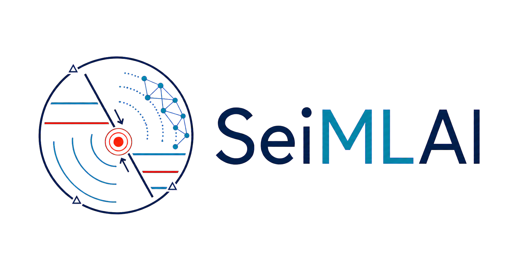

<p align="center">
  
</p>

# SeiMLAI: SEIsmic catalog for Machine Learning And Imaging

[](https://doi.org/10.5281/zenodo.22897626)

**SeiMLAI** (SEIsmic catalog for Machine Learning And Imaging) is a modular Python workflow for building high-resolution seismic catalogs from continuous waveform data. It integrates waveform acquisition, machine-learning-based P- and S-wave picking, phase association, quality control and visualization, absolute earthquake location, cross-correlation, and double-difference relative relocation into a single configurable and reproducible processing pipeline.
SeiMLAI builds on established seismological tools, including SeisBench for deep-learning phase picking, **GaMMA** for phase association, **PyGMT** for visualization, **HypoEllipse** for absolute location, and **HypoDD** for relative relocation. Location procedures are containerized with **Docker** to improve portability and reproducibility across computing environments.
The workflow can be run end-to-end from the command line or individual modules can be imported into Python applications, notebooks, and custom processing pipelines.

The product package includes the existing Seisbench (Woollam et al., 2022) and PyGMT (Tian et al., 2026) libraries for seismic data analysis using machine learning and for the preliminary visualization of the resulting catalog, respectively.

This repository can be used in two ways:

1. Run the seismic processing workflow from the command line.
2. Import `seimlai/` from Python code when developing new tools, notebooks, or tests.

If you are only using the workflow, start with the command-line section. You do not need to import Python modules manually.

## Installation & Quickstart

Create or update the Conda environment, activate it, inspect the CLI, then run the workflow:

```bash
conda env update -f environment.yml
conda activate catalog
python main.py --help
python main.py --config user_configuration/config.yaml
```
After installing the package, the same CLI is available as:

```bash
seismic-workflow --config user_configuration/config.yaml
```

The user-editable settings are in [user_configuration/config.yaml](./user_configuration/config.yaml).

## Main CLI Commands

`main.py` is the main entrypoint. It decides which workflow stages to run.

| Command | What it does |
| --- | --- |
| `python main.py` | Run the full workflow. |
| `python main.py --gui` | Launch the interactive graphical user interface (GUI). |
| `python -m seimlai.main` | Run the full workflow through the package module. |
| `seismic-workflow` | Run the installed PyPI-style entrypoint. |
| `python main.py --config user_configuration/config.yaml` | Run the full workflow with an explicit config file. |
| `python main.py continue` | Continue from absolute location, stages `04` to `05`. |
| `python main.py 02` | Run one stage by ID. |
| `python main.py absolute-location` | Prepare, run, and filter the HypoEllipse location. |
| `python main.py relative-relocation` | Prepare and run the HypoDD relocation. |
| `python main.py --from 02` | Run from stage `02` through the end. |
| `python main.py --only 04 05` | Run only the selected stage IDs. |
| `python main.py gamma-analysis` | Run optional GaMMA picking/association analysis. |
| `python main.py plot-catalog` | Run optional catalog plotting. |
| `python main.py threshold-analysis` | Run optional threshold comparison plots. |

## Graphical User Interface (GUI)

SeiMLAI includes an interactive graphical user interface (GUI) powered by [NiceGUI](https://nicegui.io/):

```bash
python main.py --gui
```
Or with a custom port and configuration file:
```bash
python main.py --gui --port 8080 --config user_configuration/config.yaml
```

The GUI offers:
- **Interactive Configuration Editor**: Visual form divided into tabs for each section of `config.yaml` (Case Study, Geography with interactive mini-map preview, Dates, Stations, Deep Learning PhaseNet/EQTransformer thresholds, GaMMA, HypoEllipse, HypoDD, and CC-DD). Provides real-time validation and automatic timestamped backups upon saving.
- **Pipeline Runner & Real-Time Progress**: Start full or selective pipeline runs (`--from`, `--only`), monitor per-stage progress bars and timers, and view a live streaming log console with auto-scroll and filtering.
- **Live Interactive Map**: Real-time Leaflet map displaying FDSN stations (blue markers) and localized earthquake hypocenters (color-coded by depth and sized by magnitude). Automatically updates as new catalogs are generated and allows switching between GaMMA, HypoEllipse, and HypoDD catalogs.
- **Dark & Light Mode**: Toggle dark/light theme on the fly.


## Independent web interface (React + FastAPI)

The `feature/separate-web-gui` branch adds a separate browser frontend in
`frontend/` and a Python HTTP/WebSocket API in `seimlai/web/`. The original
NiceGUI interface remains available with `python main.py --gui`.

### Easy start: two terminals

Use the scientific Conda environment named `catalog` and Node.js 22.12+ or 24.
If the environment has not been installed yet, create it with
`conda env update -n catalog -f environment.yml`. Install the API dependencies once:

```bash
conda run -n catalog python -m pip install 'fastapi>=0.115,<1' 'uvicorn[standard]>=0.30,<1'
```

From the repository root, start the backend in terminal 1:

```bash
./open-seimlai backend
```

Start the frontend in terminal 2:

```bash
./open-seimlai frontend
```

The frontend installs its dependencies on first use and opens the **homepage** at
**http://127.0.0.1:5173/**. Choose **Open workspace**, review the configuration,
and use **Run full workflow** or the individual stage controls. HTTP requests and
live progress go through Vite to the host scientific backend on port 8000.
Keep both terminals open; press **Ctrl+C** in each to stop its service.
Docker is only needed for the pipeline stages that use HypoEllipse/HypoDD,
not to serve this interface. Errors and pipeline output appear in the backend terminal.

If an older launch is still running, stop its host API before starting the new
backend (port 8000 must be free). The launcher no longer starts background
processes or uses PID/log files.
`run_gui.sh` and `SeiMLAI_GUI.command` still launch the original NiceGUI interface.

### Stopping and restarting

1. Press **Ctrl+C** in the frontend terminal.
2. Press **Ctrl+C** in the backend terminal.
3. Restart with `./open-seimlai backend` and `./open-seimlai frontend` in separate
   terminals.

The obsolete Docker website has been removed. If a container from an older
checkout still exists, stop it with `docker stop seimlai-web-1`. Docker remains
required for the containerized scientific location stages.

If startup reports that a port is already in use, identify its listener:

```bash
lsof -nP -iTCP:5173 -iTCP:8000 -iTCP:8001 -iTCP:8080 -sTCP:LISTEN
```

The new frontend uses 5173 and the backend uses 8000. Ports 8001 and 8080 may
belong to older SeiMLAI launches. Stop a confirmed old SeiMLAI process in its
terminal, or use `kill -TERM <PID>` with its actual PID from the output. An empty
listing means these ports are free. Stopping services does not delete your
configuration, case studies, or downloaded data.

### Web interface file layout

| Path | Responsibility |
| --- | --- |
| `open-seimlai` | Starts the backend or frontend from the repository directory. |
| `frontend/src/main.tsx` | Routes between the homepage and workspace. |
| `frontend/src/Landing.tsx`, `Landing.css` | Homepage content and animation. |
| `frontend/src/Workspace.tsx` | Pipeline controls, configuration, and live progress. |
| `frontend/src/SeismicMap.tsx` | Cesium catalog viewer and geographic selection. |
| `frontend/src/api.ts` | HTTP client and shared frontend data types. |
| `frontend/vite.config.ts` | Frontend development server and API/WebSocket proxy. |
| `seimlai/web/app.py` | FastAPI endpoints and optional built-frontend serving. |
| `seimlai/gui/services/` | Shared configuration, pipeline, and catalog services. |

For a built frontend served directly by FastAPI, run `npm ci` and `npm run build`
in `frontend/`, then start the backend and open **http://127.0.0.1:8000/**.
Rebuild after frontend changes when using this alternative. The two-terminal
startup above serves frontend changes immediately.

The workspace includes the five processing stages, continuation/selection and
utilities, case-study selection, all configuration sections, geographic bounds
selection, editable/uploadable HypoEllipse and HypoDD templates, live logs and
a Cesium 3D map. Catalog selection and camera state stay in the browser.
Configuration and model-file writes detect stale edits; model files retain a
`.bak` copy. Configuration saves retain the existing YAML comments and
case-study snapshots through the original configuration service.

**Execution model:** one trusted machine workspace, one pipeline, one API
process/worker. Browsers intentionally share the saved configuration, active
case study and execution state. This is not an isolated multiuser job system.
The API defaults to loopback and has no authentication; remote deployment needs
an authenticated HTTPS reverse proxy with WebSocket forwarding and preserved
Host/Origin, before exposing the API beyond the machine. Keep a single worker.
The scientific services are reused from `seimlai/gui/services/`, without loading
NiceGUI; the scientific processing code and CLI are unchanged.

**3D depth reference:** event height is `offset_m - depth_km * 1000`, without
vertical exaggeration. The map starts with a zero offset, treats the ellipsoid
as the surface and provides a datum offset control. Catalog depth and station
elevation datums must be checked before interpreting vertical alignment;
no geoid conversion or topographic terrain is provided. Globe transparency and
underground camera navigation expose the hypocenters. Basemaps require network
access; the default viewer does not require a Cesium ion account or token.
The home animation is explicitly illustrative and is separate from live data.

API contract checks (using the scientific environment with `httpx` installed):

```bash
python -m unittest discover -s tests -v
```

These checks use temporary configuration/workspace files and mocked job starts;
they never download waveforms or execute the scientific pipeline.

## Numbered Workflow Stages

| ID | Command | What it does |
| --- | --- | --- |
| `01` | `download` | Download data. |
| `02` | `phase-picking` | Phase picking with the configured deep-learning model available on Seisbench. |
| `03` | `association` | Phase association and raw catalog building with GaMMA. |
| `04` | `absolute-location` | Prepare input, run HypoEllipse, and filter its locations. |
| `05` | `relative-relocation` | Prepare input, generate cross-correlation differential times, and run HypoDD. |

## Single Stage Commands

The easiest way to run one stage is through `main.py`:

```bash
python main.py 02
```
The same stages can also be run by command name, for example `python main.py relative-relocation`.

Stage commands and optional commands are available through `main.py`:

```bash
python main.py plot-catalog
python main.py threshold-analysis
```

## HypoDD Docker Image

The HypoDD stage compiles `ph2dt` and `hypoDD` automatically from the official
`V2.1b` source. The value under `hypodd.docker_image` is used as the prefix for
content-addressed local image tags; it is not necessary to build the image by
hand.

The compilation uses the editable templates in `user_configuration/hypodd/`.
Effective copies are written to the case-specific
`hypodd/input&output` directory, so a run never modifies the templates tracked
by Git.

Array dimensions are selected under `hypodd.dimensions` in `user_configuration/config.yaml`:

```yaml
hypodd:
  dimensions:
    mode: auto
    maxeve0: 2
    maxlay: 50
    maxcl: 200
```

In `auto` mode, event, station, phase, and observation dimensions are calculated
from the input and generated files with 10% headroom. `MAXEVE0`, `MAXLAY`, and
`MAXCL` come from `user_configuration/config.yaml`. In `manual` mode, edit the `MANUAL` blocks in
both templates; the workflow activates those blocks and rejects statically
undersized values before compilation.

Compilation runs in two phases: `ph2dt` is built and run first, then `dt.ct` is
counted before `hypoDD` is built. Images are reused when the source version and
rendered include content have already been compiled. Runtime files are retained
in `hypodd/input&output`, while logs and final relocation files are written to
`hypodd/output`.

## Catalog Output Layout

Each catalog stores downloaded data in `archive/` and workflow results in
`output/`. A run is identified by both picking thresholds, for example
`output/threshold_p0.8_s0.8/`.

```text
archive/
  inventory/  waveforms/  stations.csv  download_log.txt
output/
  threshold_comparison/
  threshold_p<P>_s<S>/
    output_picks_<P>/
    output_catalog_<P>/
      gamma/
      hypoellipse/<dates>/
        input/
        output/
      hypodd/<dates>/
        input/
        output/
        ph2dt/
          input/
          output/
```

`threshold_comparison/` contains reports that aggregate multiple threshold
runs. For both HypoEllipse and HypoDD, data is organized under a subfolder named
after the configured dates (e.g. `2016-10-29_2016-10-31`), containing separated
`input/` and `output/` folders (plus `ph2dt/` for HypoDD). This ensures that
changing the analysis dates creates a separate folder without overwriting existing data.

## Repository Layout

| Path | Purpose |
| --- | --- |
| `main.py` | Compatibility wrapper for the package CLI. |
| `user_configuration/config.yaml` | User settings only. No calculations happen here. |
| `environment.yml` | Conda environment definition. |
| `user_configuration/` | Editable HypoEllipse models/configuration and HypoDD templates/Dockerfile. |
| `seimlai/` | Importable workflow implementation. |
| `tests/` | Smoke tests for runtime context and derived settings. |

## Using The Python Library

The `seimlai/` package exists so Python code can reuse workflow stages without copying script logic.

Run a single stage from Python:

```python
from seimlai.context import build_context
from seimlai.phase_picking import run_phase_picking

ctx = build_context("user_configuration/config.yaml")
run_phase_picking(ctx)
```

Run another stage:

```python
from seimlai.context import build_context
from seimlai.association import run_association

ctx = build_context("user_configuration/config.yaml")
run_association(ctx)
```

This is useful for notebooks, tests, new scripts, or a future interface around the same processing code.

## Inside `seimlai/`

| Module | Purpose |
| --- | --- |
| `main.py` | Main CLI orchestrator for the whole workflow. |
| `context.py` | Loads `user_configuration/config.yaml`, validates settings, builds derived paths/settings, and lazily creates heavy objects such as models, devices, transformers, and FDSN clients. |
| `download.py` | Implementation for waveform/station download. |
| `phase_picking.py` | Implementation for deep-learning models to phase picking. |
| `association.py` | Implementation for GaMMA association and raw catalog generation. |
| `absolute_location_prep.py` | Implementation for HypoEllipse/Hypo71 preparation files. |
| `hypoellipse_check.py` | Runs HypoEllipse with Docker using generated input files. |
| `location_filtering.py` | Parses HypoEllipse output and filters location results. |
| `relative_relocation.py` | Generates HypoDD input files. |
| `cc_dd.py` | Pipeline entrypoint for cross-correlation differential-time generation. |
| `hypodd.py` | Runs `ph2dt` and `hypoDD` through Docker. |
| `analysis.py` | Optional GaMMA result analysis. |
| `plotting.py` | Optional catalog plotting. |
| `threshold_analysis.py` | Optional threshold comparison analysis. |

## Understanding `user_configuration/config.yaml`

`user_configuration/config.yaml` contains explicit user settings only. It should not calculate paths, create folders, connect to services, or load models. Those runtime values are built by `seimlai.context`.

| Section | Controls |
| --- | --- |
| `case_study` | Case name, optional external output folder, and whether to run downloads. |
| `geography` | Latitude/longitude bounds for download and association. |
| `dates` | Start/end date and year. |
| `stations` | Network, channel, station filters, and FDSN providers. |
| `model` | Neural-network choice, pretrained/custom model options, batch size, and pick thresholds. |
| `phase_picking` | Runtime controls for `phase_picking.py`, such as worker counts. |
| `gamma` | GaMMA association bounds, velocity settings, DBSCAN, eikonal, and filtering parameters. |
| `analysis` | Analysis log filename. |
| `plotting` | GMT/PyGMT plotting settings. |
| `hypoellipse` | Minimum P/S picks for HypoEllipse preparation, plus velocity model and parameter file paths. |
| `hypoellipse_check` | Docker image and startup timeout for `hypoellipse_check.py`. |
| `dd` | Filters for differential relocation input generation. |
| `hypodd` | Docker image prefix, automatic/manual array dimensions, `ph2dt` parameters, relocation controls, and the 1D velocity model. |
| `cc_dd` | Cross-correlation settings for `cc_dd.py`, including workers, channels, and CC thresholds. |
| `threshold_analysis` | Threshold map and plotting DPI for `threshold_analysis.py`. |

## Mental Model

- `python main.py` runs the full workflow controller.
- `python main.py 03` runs one stage by ID.
- `python -m seimlai.main` runs the same controller through the package.
- `python main.py absolute-location` and `python main.py relative-relocation` run the two location stages by command name.
- `python main.py plot-catalog` runs an optional command through the main controller.
- `import seimlai.phase_picking` reuses the implementation from Python code.

Most users only need `main.py` and `user_configuration/config.yaml`.

## Software and references

SeiMLAI builds on the following open-source software and methods. Please cite
the relevant publications when using this workflow.

## References

SeiMLAI relies on the following open-source software and methods. Please cite
the relevant publications when using this workflow.

- **SeisBench** — Woollam, J., Münchmeyer, J., Tilmann, F., et al. (2022).
  *SeisBench—A toolbox for machine learning in seismology*. Seismological
  Research Letters, 93(3), 1695–1709.
  [https://doi.org/10.1785/0220210324](https://doi.org/10.1785/0220210324)

- **PyGMT** — Tian, D., Fröhlich, Y., Leong, W. J., et al. (2026).
  *PyGMT: Bridging Python and the Generic Mapping Tools for geospatial
  visualization and analysis*. Geochemistry, Geophysics, Geosystems, 27,
  e2026GC013105.
  [https://doi.org/10.1029/2026GC013105](https://doi.org/10.1029/2026GC013105)

- **PhaseNet** — Zhu, W., & Beroza, G. C. (2019). *PhaseNet: A
  deep-neural-network-based seismic arrival-time picking method*.
  Geophysical Journal International, 216(1), 261–273.
  [https://doi.org/10.1093/gji/ggy423](https://doi.org/10.1093/gji/ggy423)

- **GaMMA** — Zhu, W., McBrearty, I. W., Mousavi, S. M., Ellsworth, W. L.,
  & Beroza, G. C. (2022). *Earthquake phase association using a Bayesian
  Gaussian Mixture Model*. Journal of Geophysical Research: Solid Earth, 127,
  e2021JB023249.
  [https://doi.org/10.1029/2021JB023249](https://doi.org/10.1029/2021JB023249)

- **EQTransformer** — Mousavi, S. M., Ellsworth, W. L., Zhu, W., Chuang,
  L. Y., & Beroza, G. C. (2020). *Earthquake transformer—An attentive
  deep-learning model for simultaneous earthquake detection and phase
  picking*. Nature Communications, 11, 3952.
  [https://doi.org/10.1038/s41467-020-17591-w](https://doi.org/10.1038/s41467-020-17591-w)

- **HYPOELLIPSE** — Lahr, J. C. (1989). *HYPOELLIPSE/version 2.0: A computer
  program for determining local earthquake hypocentral parameters, magnitude,
  and first-motion pattern*. U.S. Geological Survey Open-File Report 89-116.
  [https://doi.org/10.3133/ofr89116](https://doi.org/10.3133/ofr89116).
  Software implementation: [INGV/hypoellipse](https://github.com/INGV/hypoellipse).

- **Docker** — Merkel, D. (2014). *Docker: Lightweight Linux containers for
  consistent development and deployment*. Linux Journal, 239, 2.

- **hypoDD** — Waldhauser, F., & Ellsworth, W. L. (2000). *A double-difference
  earthquake location algorithm: Method and application to the Northern Hayward
  Fault, California*. Bulletin of the Seismological Society of America, 90(6),
  1353–1368.
  [https://doi.org/10.1785/0120000006](https://doi.org/10.1785/0120000006)

  Waldhauser, F. (2001). *hypoDD—A program to compute double-difference
  hypocenter locations*. U.S. Geological Survey Open-File Report 01-113.
  [Software repository](https://github.com/fwaldhauser/HypoDD).

## Citation

If you use **SeiMLAI** in your research, please cite:

> Fonzetti R., Crocetta A., and Bailo D., (year)
> National Institute of Geophysics and Volcanology (INGV), Rome, Italy
> *SeiMLAI: SEIsmic catalog for Machine Learning And Imaging*. **Under review at Applied Computing and Geosciences** (Submission ID: ACAGS-D-26-00330)

## License

This work is licensed under the [GNU Affero General Public License v3.0](LICENSE), unless otherwise stated.

Individual software packages, data services, waveform data, station metadata and external images remain subject to their respective licenses and terms of use.

## Contacts

**Corresponding author:** [Rossella Fonzetti]  
[National Institute of Geophysics and Volcanology (INGV), Rome, Italy][rossella.fonzetti@ingv.it](mailto:rossella.fonzetti@ingv.it)

**Co-author:** [Alessandro Crocetta]
[National Institute of Geophysics and Volcanology (INGV), Rome, Italy]
[alessandro.crocetta@ingv.it](mailto:alessandro.crocetta@ingv.it)

**Co-author:** [Daniele Bailo]
[National Institute of Geophysics and Volcanology (INGV), Rome, Italy]
[daniele.bailo@ingv.it](mailto:daniele.bailo@ingv.it)


For questions, bug reports, please contact the Co-author [Alessandro Crocetta].
For collaborations related to SeiMLAI contact the Corresponding author [Rossella Fonzetti].
